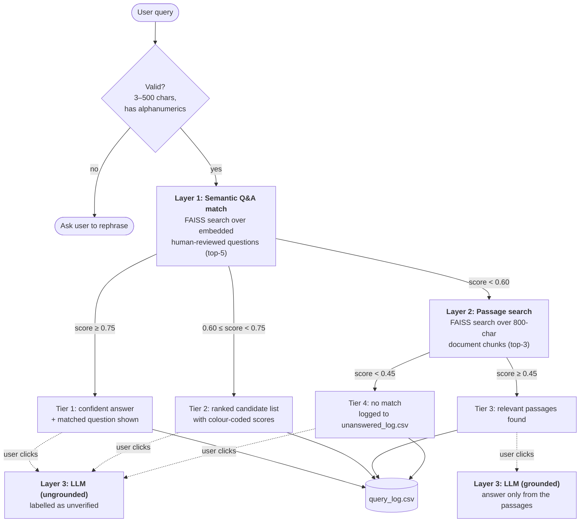

# Semantic Q&A Assistant

[](https://github.com/Mo24567/semantic-qa-assistant/actions/workflows/tests.yml)
[](LICENSE)

A retrieval-first question-answering assistant for dense policy documents. It answers from a
human-reviewed knowledge base first, then from document passages, and generates an answer with an
LLM only when the user explicitly asks for one. Every query is logged, and queries the system cannot
answer are logged separately so the knowledge base can be improved.

A personal project, evaluated against six official Loughborough University policy documents,
including the Terms and Conditions of Study, the Attendance and Engagement Policy, and the Halls of
Residence licence.

---

## The problem

People ask questions in everyday language, but policy documents are written in formal terminology.
Existing approaches fail in three predictable ways:

| Problem | What goes wrong | How this system responds |
|---|---|---|
| **Vocabulary mismatch** | Keyword search (e.g. BM25) misses relevant content when the user's words differ from the document's. *"Can I miss lectures?"* shares almost no terms with *"unsatisfactory attendance"*. | Semantic search with sentence embeddings matches on meaning rather than shared words. |
| **Hallucination** | A bare LLM gives fluent, confident answers that aren't grounded in the actual policy. | Retrieval comes first. Generation only runs on explicit user request, and is grounded in retrieved passages where they exist. |
| **Silent failure** | When retrieval finds nothing useful, most systems still return *something*, and nobody learns that the knowledge base has a gap. | Every unanswered query is logged with its closest near-miss, giving admins a prioritised list of gaps to fill. |

## How it works

The `HybridRetriever` runs up to three layers in order and stops at the first one that clears its
threshold:



| Setting | Value | Why |
|---|---|---|
| Q&A retrieval threshold | **0.60** | Chosen by sensitivity analysis (see [below](#threshold-selection)). The code default when unset is 0.55. |
| Display threshold | **0.75** | Separates *how* a result is shown from *whether* it's returned. Matches between 0.60 and 0.75 are shown as candidates, not as one confident answer. |
| Passage threshold | **0.45** | Lower than the Q&A threshold because an 800-character chunk carries surrounding context, so it sits further from the query in embedding space. |
| Embedding model | `all-MiniLM-L6-v2` | Small and fast on CPU (NFR-01), with cosine similarity via normalised inner product (`IndexFlatIP`). |
| LLM | `gpt-4o-mini` | Used only as a fallback, on explicit user action. |

There are two separate Streamlit apps:

- **`app.py`**: the user-facing search interface.
- **`admin.py`**: a password-protected dashboard with five pages:
  - **Documents:** upload PDFs, generate Q&A suggestions, review them, or upload curated CSVs.
  - **Knowledge Base:** soft-delete and restore pairs.
  - **Testing:** batch query feeds, BM25 vs semantic comparison, full-system capture, and query logs.
  - **Evaluation:** layer distribution, confidence bands, coverage curve and gap analysis.
  - **Settings.**

Documents become a knowledge base in four steps: text extraction, GPT-drafted Q&A pairs, mandatory
human review, then indexing.

## Results

The evaluation used 133 natural-language queries written by me, 25 of them deliberately out of
scope, run against a knowledge base of **493 Q&A pairs and 245 passages from 6 PDFs**. All figures
come from the evaluation.

### Semantic search vs BM25 (Q&A layer only, 103 queries with known answers)

| Query length | n | BM25 Top-1 | Semantic Top-1 | Gap |
|---|---|---|---|---|
| 1–2 words | 15 | **26.7%** | 20.0% | −6.7 pp |
| 3–4 words | 21 | 23.8% | 23.8% | 0.0 pp |
| 5–7 words | 21 | 33.3% | **38.1%** | +4.8 pp |
| 8–11 words | 30 | 16.7% | **30.0%** | +13.3 pp |
| 12+ words | 16 | 12.5% | **18.8%** | +6.3 pp |
| **Overall** | **103** | **22.3%** | **27.2%** | **+4.9 pp** |

Semantic search pulls ahead as queries get longer and more conversational, which is where
vocabulary mismatch bites. BM25 wins on very short exact-term queries. The overall gap is narrowed by
two factors in the method: semantic search is allowed to *decline* below 0.60 while BM25 always
answers, and scoring requires an exact match on the expected question.

### Full pipeline

| Metric | Result |
|---|---|
| In-scope queries resolved by retrieval alone, with no LLM | **88.0%** (95 / 108) |
| All queries resolved by retrieval alone, including the 25 out-of-scope | 71.4% (95 / 133) |
| Useful responses: grounded (passage-based) vs ungrounded LLM | **72.7% vs 5.3%** |
| Ungrounded LLM answers that were hallucinated | 26.3% (10 / 38); a further 68.4% were generic, not institution-specific |
| Knowledge base gaps surfaced by the unanswered log | 38 queries, in 5 topic clusters |
| Coverage as the knowledge base grew from 50 to 493 pairs | **9.7% → 52.4%** |
| Generated Q&A candidates approved in human review | **89.4%** (496 / 555; 59 rejected) |

### Manual correctness of each layer

| Layer | Correct / relevant | Partial | Incorrect / not relevant |
|---|---|---|---|
| Q&A match (58 queries) | **56.9%** | 19.0% | 24.1% |
| Passage search, in-scope only (22 queries) | 72.7% useful (relevant + partially relevant) | | |
| Ungrounded LLM (38 queries) | 5.3% | 68.4% generic | 26.3% hallucinated |

### Threshold selection

**0.60** was chosen from 0.55, 0.60, 0.65 and 0.70 (133 queries, LLM off). It drops the weakest
borderline matches for only four more unanswered queries, while higher values starve the Q&A layer
without finding new gaps.

## Key design decisions

- **Embed questions, not answers.** User queries look like questions, so they sit closer to stored questions than to policy text.
- **Threshold chosen by sensitivity analysis.** A wrong policy answer is worse than no answer, so 0.60 favours confidence without starving the Q&A layer.
- **Two thresholds: retrieval and display.** 0.60 decides *whether* a result is returned, and 0.75 decides whether it's shown as one confident answer.
- **LLM generation requires an explicit click.** Users see what retrieval found first, and ungrounded answers were useful only 5.3% of the time.
- **Human review of generated Q&A is mandatory.** GPT drafts included wrong fees and misleading scope, and 10.6% were rejected.
- **Failures are logged, not hidden.** Each miss is stored with its near-miss score, so admins can tell a small gap from a missing topic.
- **Exact search with FAISS `IndexFlatIP`.** At a few hundred vectors it's effectively instant, with no approximation error.
- **Separate user and admin processes.** PDF parsing, embedding and API calls never block the user-facing app.

## Live demo

**Try it live:** https://semantic-app-assistantgit-xndz7ayaq67c3bmygahrwz.streamlit.app/
(free-tier app; if it has been idle it can take 20-30 seconds to wake up)

The public demo runs `app.py` with `DEMO_MODE=true`:

- **No answer generation.** Any OpenAI key is blanked *before settings load*, not just hidden, and
  no generation buttons are rendered, so there is no API cost and no key to leak.
- **Sample data:** [`demo/qa_pairs.csv`](demo/qa_pairs.csv) holds 149 human-reviewed Q&A pairs
  from one evaluation document, the *Halls of Residence Licence T&Cs 2026/27*, indexed on first
  start at the evaluated 0.60 threshold.
- **No passage search.** Passages were excluded because they contain verbatim copyrighted document
  text, so layer 2 never fires. Expect many *no match* results. Try *"are there noise rules in
  halls"* or *"how do I return my keys"*.

To deploy it on [Streamlit Community Cloud](https://streamlit.io/cloud):

1. Create a new app from this repo with main file `app.py`. Under *Advanced settings*, pick
   the lowest Python version offered (3.10 is not available on Streamlit Community Cloud as
   of this writing; 3.11 works).
2. Under *Secrets*, add `DEMO_MODE = "true"`. Streamlit exposes root-level secrets as environment
   variables. Do **not** add an OpenAI key.
3. The first load takes about a minute while the embedding model downloads and the indexes build.

## Getting started

Requires Python 3.10. An OpenAI API key is only needed for Q&A generation in the admin app and for
the optional generation buttons.

```bash
git clone https://github.com/Mo24567/semantic-qa-assistant.git
cd semantic-qa-assistant
python -m venv venv && source venv/bin/activate   # Windows: venv\Scripts\activate
pip install -r requirements.txt
cp .env.example .env                               # set OPENAI_API_KEY and ADMIN_PASSWORD
```

**Try it with the sample data, no API key needed:**

```bash
DEMO_MODE=true streamlit run app.py                # PowerShell: $env:DEMO_MODE="true"; streamlit run app.py
```

**Run the full system:**

```bash
streamlit run app.py                               # user app on :8501
streamlit run admin.py --server.port 8502          # admin app on :8502
```

In the admin app, upload PDFs on the Documents page, generate and review Q&A suggestions, then
rebuild the index. The same steps from the command line, run from the repo root:

```bash
python -m src.ingestion.extract_documents          # data/raw_docs/*.pdf  -> document_chunks.csv
python -m src.ingestion.generate_draft_qas         # chunks -> draft_qas.csv (OpenAI)
# review drafts in the admin app -> data/raw/approved_qas.csv
python -m src.ingestion.load_dataset               # data/raw/*.csv -> qa_dataset_clean.csv
python -m src.retrieval.build_index                # Q&A index
python -m src.retrieval.build_chunk_index          # passage index
```

### Docker

```bash
docker build -t semantic-qa-assistant .
docker run -p 8501:8501 -e DEMO_MODE=true semantic-qa-assistant   # demo with sample data

cp .env.example .env                                              # full system: user + admin apps
docker compose up --build                                         # :8501 and :8502, shared ./data
```

The image uses CPU-only PyTorch and has the embedding model baked in, so containers start without a
download.

### Tests

```bash
python -m pytest
```

There are 25 tests covering configuration loading, the hybrid retriever's layer routing (with the
retrievers and LLM mocked), chunking, dataset cleaning and text utilities. GitHub Actions runs them on
every push and pull request. They check that the code behaves correctly. They do **not** measure
retrieval quality; that is what the evaluation is for.

All settings are documented in [`.env.example`](.env.example). If `ADMIN_PASSWORD` is unset it
defaults to `admin`, so change it.

## Project structure

```
app.py, admin.py   User app and admin dashboard (separate Streamlit processes)
src/               retrieval/, ingestion/, llm/, utils/, demo/
demo/              Sample Q&A pairs for the public demo
evaluation/        Query sets used in the evaluation (133 feed, 103 comparison)
tests/             pytest suite
data/              Runtime data, git-ignored (uploads, indexes, logs)
```

## Known limitations

- **The Q&A layer is right only 56.9% of the time.** Of 58 Q&A matches, 33 were correct, 11
  partially correct and 14 incorrect. The main cause is that cosine similarity measures *semantic
  closeness*, not *whether the answer addresses the question*. A query can land on the right topic
  but the wrong clause, and an out-of-scope query (e.g. GP registration) can clear 0.60 against an
  unrelated pair (student registration). Threshold tuning can't fix this; it would need a relevance
  check such as a re-ranker or intent classification. This is why the UI always shows the matched
  question, so users can catch a wrong match.
- **"Grounded 72.7%" compares different things.** It is the in-scope usefulness of passage-search
  results, compared against the correctness of ungrounded LLM answers. The evaluation did not score
  the grounded LLM's own generated answers.
- **The evaluation is author-built and non-blind.** I wrote the 133 test queries and annotated the
  results myself, knowing the expected answers, so the correctness figures are probably optimistic
  and may not reflect real user queries.
- **Prototype security.** There is one shared admin password (default `admin` if unset), no per-user
  accounts, and logs are flat CSV files. Fine for a single-tenant prototype, but not for production.

Further limitations include no precision or recall, a single embedding model, fixed-size chunking,
unmeasured latency, a threshold tuned on the evaluation queries, and unlogged generated answers.

## Tech stack

Python 3.10 · Streamlit · sentence-transformers (`all-MiniLM-L6-v2`) · FAISS · OpenAI API
(`gpt-4o-mini`) · pypdf · pandas · rank-bm25 · Plotly · pytest · Docker · GitHub Actions

## License

[MIT](LICENSE)
